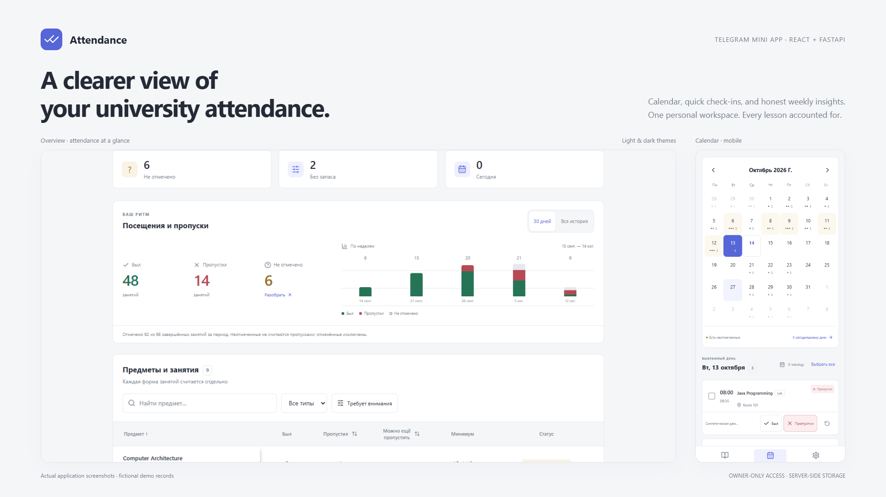
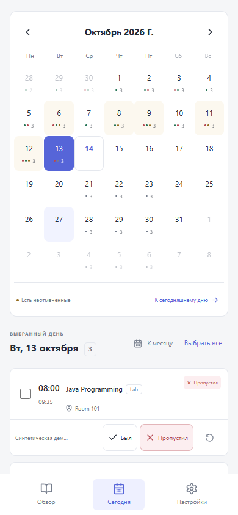
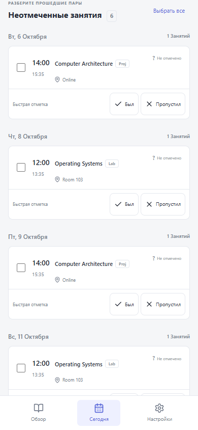
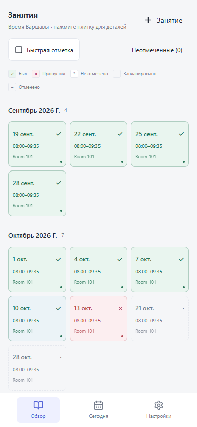
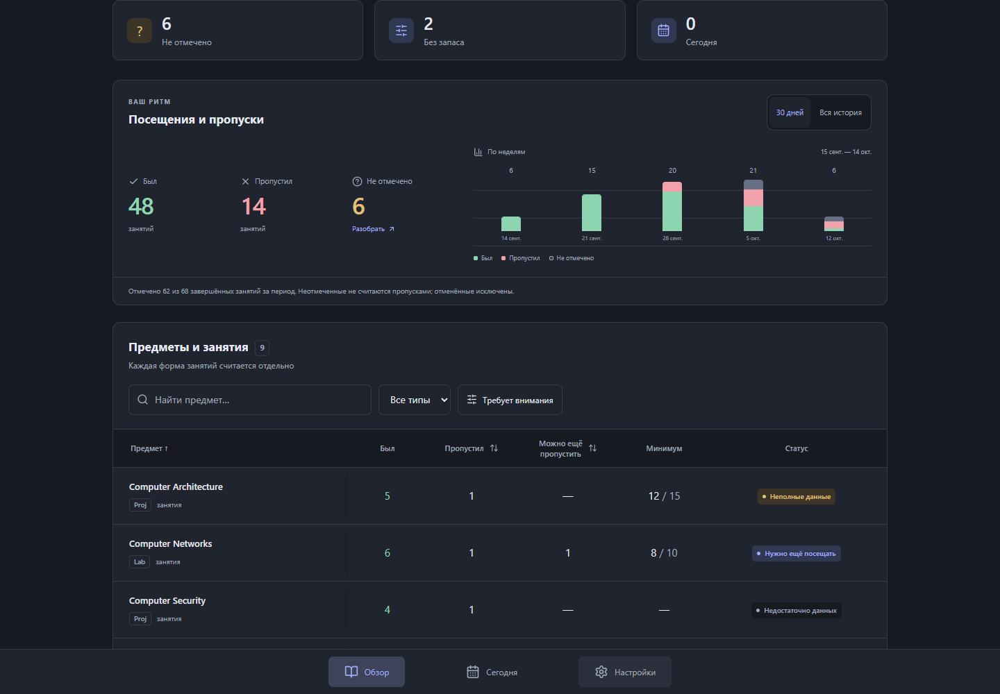

<p align="center"></p>
<h1 align="center">Attendance</h1>
<p align="center"><strong>A clearer view of your university attendance.</strong><br>Calendar, quick check-ins, and honest weekly insights — inside Telegram.</p>
<p align="center">
  <a href="https://github.com/mtdfilm/attendance-mini-app/actions/workflows/ci.yml"></a>
  
  
  
  
</p>
<p align="center"><a href="#what-it-does">Features</a> · <a href="#run-locally">Quick start</a> · <a href="docs/setup.ru.md">Инструкция на русском</a> · <a href="docs/architecture.md">Architecture</a></p>


<p align="center"><sub>Real application screenshots. All preview records are fictional demo data.</sub></p>

## What it does

A personal Telegram Mini App for keeping university attendance organised. Each course form has its own requirements and history; a calendar or a single backlog lets you mark lessons without jumping between subjects.

| Keep track | Move faster | Keep your history |
| --- | --- | --- |
| Separate Lab, W, C and other course forms | Mark directly from a day or a cross-course list | Record versions prevent lost updates |
| Exact minimums and remaining absence budgets | Select several lessons and apply one status | Undo an entire batch in one action |
| Weekly present / absent / unmarked insights | Search subjects, types and rooms | Import previews preserve attendance and overrides |
| Month calendar in Warsaw time | Light and dark themes, touch-friendly controls | Export JSON and restore with a SQLite backup |

**Unknown stays unknown.** Unmarked lessons are not absences. An upcoming calendar does not prove the semester is complete. Charts describe recorded history; they do not replace per-component attendance requirements.

## A few closer looks

<table>
<tr><td align="center"><strong>Pick a day</strong></td><td align="center"><strong>Clear the backlog</strong></td><td align="center"><strong>Mark a course</strong></td></tr>
<tr><td></td><td></td><td></td></tr>
</table>

<details>
<summary><strong>Dark mode preview</strong></summary>



</details>

## Run locally

Requires **Python 3.12+** and **Node.js 22+**. Dependencies are pinned in the Python and npm lockfiles.

### Windows · PowerShell

```powershell
py -3.12 -m venv .venv
./.venv/Scripts/python.exe -m pip install -r backend/requirements.lock.txt
Copy-Item .env.example .env
cd frontend
npm.cmd ci
npm.cmd run build
cd ..
powershell -ExecutionPolicy Bypass -File ./scripts/dev.ps1
```

Open **http://127.0.0.1:8000**. This explicitly enables local development authentication and displays a banner. The working database starts empty.

### Linux / macOS

```sh
python3 -m venv .venv
.venv/bin/python -m pip install -r backend/requirements.lock.txt
cp .env.example .env
cd frontend && npm ci && npm run build && cd ../backend
../.venv/bin/python -m alembic upgrade head
DEV_AUTH_BYPASS=true ../.venv/bin/python -m uvicorn app.main:app --host 127.0.0.1 --port 8000 --no-access-log
```

<details>
<summary><strong>Try fictional demo records</strong></summary>

On Windows, run `scripts/dev.ps1 -Demo`. It uses a separate `demo.db` and refuses to seed a non-empty database. Development mode and an explicit auth bypass are required.

For browser QA, `python scripts/qa_schedule.py` starts an isolated synthetic fixture on loopback port 8002. The fixture never reads a personal calendar export.

</details>

## Use it in Telegram

1. Create a bot with **@BotFather**.
2. Set `BOT_TOKEN` and your numeric `OWNER_TELEGRAM_ID` in your ignored `.env`.
3. Serve the app over HTTPS and set `PUBLIC_APP_URL`.
4. Start the bot and send it `/start`.

The backend validates Telegram's signed `initData`, its age and the owner ID before issuing a one-hour bearer session. All data endpoints are protected. Development authentication is forbidden in production.

For a temporary Windows preview, `scripts/telegram.ps1` creates a verified Cloudflare Quick Tunnel, sets the bot's app button, and launches the app and bot in the background. `scripts/telegram-stop.ps1` stops those managed processes. A permanent deployment can use Docker Compose with a persistent SQLite volume and an HTTPS reverse proxy.

**[Full setup, BotFather, Docker and backup instructions →](docs/setup.ru.md)**

## Import a calendar

Create the semester with its real boundaries, then upload an `.ics` file in Settings. The preview lists new entries, updates, cancellations and possible duplicates before saving. Type and group identities are kept separate; an ambiguous match needs an explicit choice.

Optional USOS synchronisation reads `USOS_ICAL_URL` only on the backend. Secret URLs are never returned by the API or put into the frontend bundle. Older lessons missing from an upcoming feed can be restored from a full file or added manually.

## Built with

- **React 19, TypeScript, Vite, Tailwind CSS** and small accessible UI components.
- **FastAPI, SQLAlchemy 2, Alembic, SQLite / WAL** for durable state.
- **icalendar + recurring-ical-events** for folding, time zones, recurrence and exceptions.
- **Playwright** for actual desktop and 360 px browser checks.

No external database or background queue is required. Production is one application worker on one server.

## Verification

```sh
cd backend
python -m pytest -q
cd ../frontend
npm run typecheck
npm run build
```

GitHub Actions checks backend tests and migrations, then the frontend typecheck and production build. Targeted tests cover decimal rounding, incomplete data, atomic marks and undo, Telegram signatures, calendar identity, export/restore and real server restarts.

[Validation notes](VALIDATION.md) · [Architecture](docs/architecture.md) · [Credential handling](SECURITY.md)

---

<p align="center"><sub>A focused personal tool: attendance, clear requirements, and a history you can trust.</sub></p>
