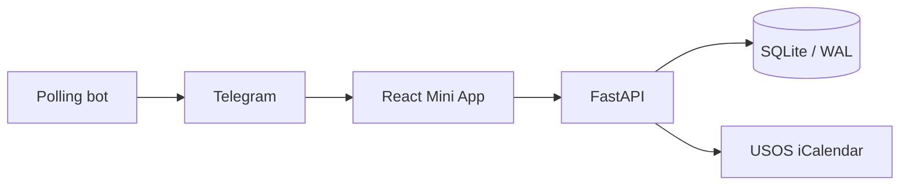

# Small by design

One owner, one application server, one persistent SQLite database. The built React app and FastAPI API share an HTTPS origin in deployment.

| Area | Responsibility |
| --- | --- |
| `backend/app/calculations.py` | Pure attendance requirements with exact decimal rounding |
| `backend/app/analytics.py` | Descriptive weekly history; unknown marks stay separate |
| `backend/app/services.py` | Session state and component summaries |
| `backend/app/importer.py` | Calendar expansion, preview, identity and safe USOS fetching |
| `backend/app/auth.py` | Signed Telegram data and expiring owner sessions |
| `backend/app/backup.py` | Validated JSON restore and consistent SQLite backups |
| `frontend/src/ScheduleWorkspace.tsx` | Calendar, backlog, direct marks and batch selection |
| `frontend/src/AttendanceDashboard.tsx` | Charts based on server aggregates |

Schedule fields and personal attendance are separate. Imported lessons retain manual overrides. The identity is `source + UID + occurrence`, so an update can preserve attendance. An upcoming feed never deletes missing historical lessons or establishes semester completeness.

Writes use record versions. A batch and its undo each use one transaction; replaying an attendance request ID is idempotent. The client serializes quick writes, rolls back a rejected optimistic state and ignores stale summary responses.

Attendance requirements are computed per course component. The progress towards a minimum, the current known marks and the descriptive number of attended lessons are different measures. Unknown policies, incomplete histories, unmarked lessons and missing academic units remain explicit.

SQLite is stored on a persistent local disk. Deployment uses one worker; multiple replicas, network filesystems and automatic backup delivery are outside this project's current design.
